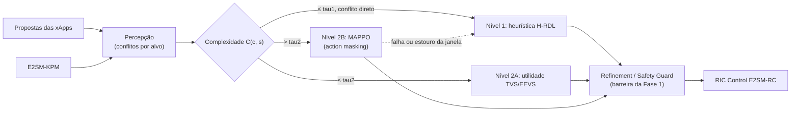

# xApp RDL — Resource and Decision Layer (Fase 2: CA-RDL)

Extensão da camada de governança da Fase 1 para o Near-RT RIC (O-RAN): além da arbitragem determinística (H-RDL), um nível de decisão aprendida (MAPPO com restrições e *action masking*) para conflitos de maior complexidade, com a H-RDL como reserva determinística e o Safety Guard da Fase 1 como barreira final.

Projeto de mestrado — PPGCOMP / UFPA. Autor: George Alexandro Ferreira Barbosa. Orientador: Prof. Dr. André Riker.

| Fase | Abordagem | Repositório |
| :-- | :-- | :-- |
| 1 — H-RDL | Heurísticas determinísticas (TVS/EEVS) + Safety Guard; E2 real com NORI | [XApp-RDL-F1](https://github.com/georgebarbosa3090/XApp-RDL-F1) |
| 2 — CA-RDL | Contexto + Safe-MARL (MAPPO com restrições) | este repositório |
| 3 | RDL autônoma/federada (6G) | planejamento |

---

## Estado atual (2026-11-10)

**Este repositório está em reconstrução e não tem resultados experimentais.** Em 2026-11-10 saíram daqui as execuções, tabelas, figuras e relatórios que eram sintéticos ou montados por script; o registro completo está em [`docs/SANEAMENTO_20261110.md`](docs/SANEAMENTO_20261110.md). Para resultados com evidência (E2 real, closed loop, campanhas pareadas), veja a Fase 1.

| Item | Situação |
| :-- | :-- |
| Decisão em níveis (`src/agents/reasoning_agent.py`): heurística (nível 1), utilidade TVS/EEVS (nível 2A), MAPPO (nível 2B) por limiares de complexidade `tau1`/`tau2` | implementado; testes unitários |
| MAPPO (`src/agents/marl/mappo_agent.py`) | arquitetura implementada; **a inferência usa rede não treinada** (nenhum checkpoint é carregado) e força confiança ≥ 0,80 |
| Treino (`src/agents/marl/mappo_trainer.py`, `experiments/training/`) | só teste de fumaça com observações aleatórias; manifestos `publication_eligible: false` |
| Ambiente de treino `NoriRanEnvironment` | tabela fixa de vazão/latência por faixa de cota; **não conversa com o NORI** |
| Grafo de conhecimento / GNN (GraphSAGE) / janela adaptativa | **não implementados** |
| Classificador de intenção | *stub* treinado com dados aleatórios |
| Reserva determinística para a H-RDL em ≤ 200 ms | não verificada |
| Interoperabilidade E2 | código anterior às correções da Fase 1 (ex.: `rmr_send` sem MEID; cota de PRB fora do E2SM-RC Style 2 / Action 6); **nenhuma execução E2 registrada aqui** |
| Cenários ns-3 (`simulations/ns3/`) | versões anteriores às correções da Fase 1; S9–S15 nunca executados |
| Afirmações C1–C6 ([`specs/claims.yaml`](specs/claims.yaml)) | todas `NOT_VERIFIED` |
| Testes | 111 passam, 2 pulados; cobertura de `src/` 79 % |
| Demonstração (`experiments/demonstration/`) | roteiro sobre um modelo de RAN em Python; **não é evidência** |

Próximos passos, em ordem: (1) passar a importar o núcleo atual da Fase 1 em vez desta cópia antiga; (2) ambiente de treino ligado ao NORI pela xApp da Fase 1; (3) treino com proveniência e checkpoint carregado na inferência; (4) gate da reserva determinística; (5) comparação H-RDL × CA-RDL pré-registrada. Detalhes em [`docs/SANEAMENTO_20261110.md`](docs/SANEAMENTO_20261110.md), seção 4.

---

## Como a CA-RDL decide (desenho)



O contrato com a Fase 1 está em [`docs/compliance/PHASE1_PHASE2_SYNC_CONTRACT.md`](docs/compliance/PHASE1_PHASE2_SYNC_CONTRACT.md): a Fase 2 só acrescenta campos opcionais aos tipos de `src/conflict_types.py`, e toda ação passa pelo Refinement antes do despacho.

---

## Início rápido

Pré-requisitos: Python 3.10+.

```bash
python -m venv .venv && . .venv/bin/activate
pip install -r requirements.txt
USE_FAKE_SDL=True pytest -q                     # testes
python scripts/check_no_synthetic_results.py    # auditor de dados sintéticos
python -m src.main                              # xApp em modo local, sem RIC
```

---

## Estrutura do repositório

| Caminho | Conteúdo |
| :-- | :-- |
| `src/` | xApp: `rdl_xapp.py`, `agents/` (percepção, raciocínio, refinamento, `marl/`), `e2/`, `infrastructure/`, `coordination/`, `observability/`, `simulation/` (modelo de RAN em Python) |
| `tests/` | testes unitários, de codec, integração e interoperabilidade local |
| `simulations/ns3/` | cenários ns-3 (versões antigas; ver aviso no README da pasta) |
| `experiments/training/` | manifestos e pesos dos testes de fumaça do MAPPO |
| `experiments/demonstration/` | demonstração interativa (não é evidência) |
| `reference-xapps/` | xApps que geram propostas (xSlice, Energy Saving, Traffic Steering, Beamformer, ISAC, *rogue*) |
| `deploy/`, `deployments/` | Helm, Kubernetes, telemetria (InfluxDB/Grafana) |
| `reproducibility/` | política de proveniência e versões |
| `specs/claims.yaml` | afirmações científicas e seu estado |
| `docs/` | documentação ([índice](docs/README.md)) |

---

## Licença

Apache License 2.0 — ver [`LICENSE`](LICENSE).
