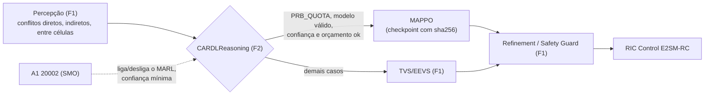

# xApp RDL — Fase 2: CA-RDL (arbitragem aprendida sobre a H-RDL)

Projeto de mestrado — PPGCOMP / UFPA. Autor: George Alexandro Ferreira Barbosa. Orientador: Prof. Dr. André Riker.

| Fase | Abordagem | Repositório |
| :-- | :-- | :-- |
| 1 — H-RDL | Núcleo: percepção (inclusive conflitos entre células), TVS/EEVS, Safety Guard, grafo de conhecimento, janela adaptativa, A1, E2 real com NORI | [XApp-RDL-F1](https://github.com/georgebarbosa3090/XApp-RDL-F1) |
| 2 — CA-RDL | MAPPO com restrição (CMDP) e mascaramento, com a H-RDL como reserva determinística | este repositório |

## Arquitetura

A Fase 2 **não copia** o núcleo: depende do pacote da Fase 1 (`xapp-rdl-f1`, fixado por commit no `pyproject.toml`) e só acrescenta o motor de decisão aprendido.



| Módulo | Conteúdo |
| :-- | :-- |
| `cardl/engine.py` | `CARDLReasoning` (subclasse do `Reasoning` da F1) e `build_cardl_xapp()` (a `RDLxApp` da F1 com o motor CA-RDL e a política A1 20002) |
| `cardl/marl/calibration.py` | curva teto de PRB → vazão medida no NORI (`cardl/calibration/slice_cap_curve_v5.json`, sha256 verificado) |
| `cardl/marl/env.py` | ambiente CMDP multiagente calibrado: 2 fatias, propostas de RANSlicer, EnergySaver e Rogue, Safety Guard da F1 como máscara |
| `cardl/marl/mappo.py` | MAPPO com crítico centralizado, mascaramento e multiplicador de Lagrange |
| `cardl/marl/baselines.py` | B0–B2 e B3 (o `Reasoning` real da F1) no mesmo ambiente |
| `cardl/marl/train.py` | treino com proveniência (commit, versão da F1, sha256 da curva e do checkpoint) e avaliação contra B0–B3 |

## Estado (2026-11-10)

- **Treino:** `experiments/training/mappo_seed{101,102,103}`, 2000 episódios cada, no ambiente calibrado (`publication_eligible: false`). Na avaliação em 20 sementes separadas, a H-RDL (B3) atende o SLA crítico em todas as janelas. O MAPPO economiza PRBs ativos em uma semente, sacrificando a fatia eMBB, e é instável em outra; **não supera a H-RDL** neste ambiente. Detalhes em [`docs/15_treino_mappo_calibrado.md`](docs/15_treino_mappo_calibrado.md).
- **Validação com E2 real (NORI):** a pré-registrar; nenhuma execução ainda.
- **Afirmações C1–C6:** `NOT_VERIFIED` ([`specs/claims.yaml`](specs/claims.yaml)).
- **Histórico:** em 2026-11-10 saíram deste repositório os dados sintéticos ([`docs/SANEAMENTO_20261110.md`](docs/SANEAMENTO_20261110.md)) e a cópia antiga do núcleo, substituída pela dependência da Fase 1.

## Uso

```bash
python -m venv .venv && . .venv/bin/activate
pip install -e ../XApp-RDL-F1          # núcleo da Fase 1 (ou o commit fixado no pyproject)
pip install -e ".[test]"
pytest -q
python -m cardl.marl.train --seeds 101 102 103 --episodes 2000 --out experiments/training
```

Na xApp: `CARDL_CHECKPOINT` e `CARDL_CHECKPOINT_SHA256` apontam o modelo. Sem eles, ou com a política A1 20002 desligando o MARL, a decisão é a da H-RDL.

## Licença

Apache License 2.0 — ver [`LICENSE`](LICENSE).
